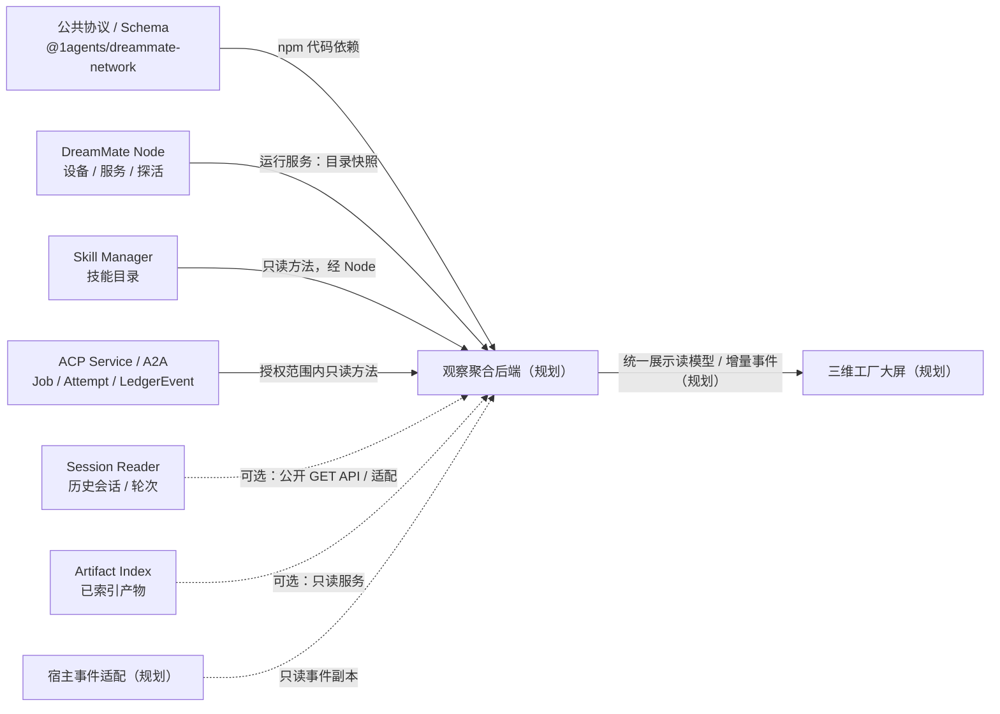
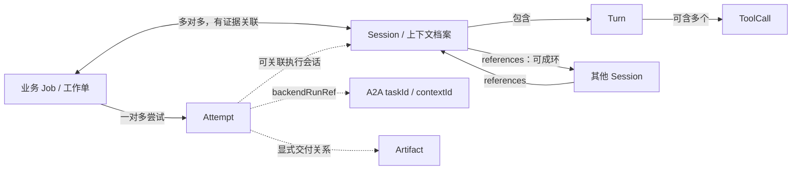

# DreamMate Visualizer · 已确认设计基线

一芥天地（DreamMate World）分布式设备与能力网络的独立三维观察应用。第一优先级是让人**像看工厂大屏一样，直观看到全网正在怎样协作**，再下钻到设备、能力、工作单、会话和轮次。

> 本文是 2026-10-22 开发前保留的方案基线，文中“当前阶段”“规划”“尚未实现”描述初始化当时的状态。实际交付和运行方式请以[项目 README](../README.md)为准。

**基线阶段：仅方案与最小仓库初始化，尚无可运行三维应用。** 本仓库只有本说明、`package.json` 和 `.gitignore` 等初始化文件；没有页面、观察后端、开发脚本或已安装依赖。下文标为“规划”的界面、目录、读模型、事件接口和里程碑都尚未实现。本文核对的是 2026-10-22 的本地源码，不证明相应版本已发布或服务已部署。

## 1. 定位、场景与独立边界

一芥天地是分布式、自主申报的设备与能力网络：设备是芥子（DreamMate Node），Service 提供 Method、Resource 和 Skill；Agent 既可直接调用工具，也可通过 A2A 委托其他 Agent。实际执行分布在各节点，观察应用汇集可见事实，帮助人理解协作。

典型场景：

- 看全局：有哪些设备、已申报什么能力、哪些服务可用，哪里正在执行、等待用户或发生异常。
- 看接力：从一个业务工作单进入各次尝试，查看可证实的委托与调用关系，以及涉及的设备和角色。
- 看细节：按需打开会话与轮次，检查工具调用证据、历史引用和交付产物。
- 看缺口：辨别离线、过期、无权限、接口不支持与真实空结果，知道当前画面覆盖到哪里。

项目固定在 `/Users/scott/Documents/01-开发项目/1agents/dreammate-visualizer`。上级 `1agents` 是普通工作目录，各项目独立 Git、版本与发布，不合并为 monorepo。本项目独立维护；相邻仓库只作为公开协议、运行服务及本次只读证据来源，不共享构建、不修改其配置。依据见[工作区说明][workspace]。

本应用定位为观察面：当前不增加调度、派单、取消、重试、启动或停止服务等执行控制。`1agents_app` 整体是已停止开发的历史工作台；其中独立的 `modules/1acp` 仅提供 ACP 代码证据，不作为本应用的界面或工程基础。

## 2. 核心包与依赖关系

| 项目 / 包 | 在本项目中的角色 | 关系类型与采用决定 | 本地源码版本 |
| --- | --- | --- | --- |
| `@1agents/dreammate-network` | 公共 Node / Service / Execution / SessionRef 词汇与 Schema | **npm 代码依赖**；本次直接声明精确 `0.5.0`，尚未安装；使用正式根导出与 `./schemas/*.json` | 0.5.0 |
| `@1agents/dreammate-node` | 设备地址簿、服务声明与探活数据源 | **运行中服务**；观察后端按公开 HTTP / MCP 读取，不为读取目录引入整个包 | 0.15.1 |
| `@1agents/skill-manager` | 有来源、版本与诊断的技能目录 | **运行中服务**；经 Node 已报备的目录/读取方法访问，不成为本仓 npm 依赖 | 0.2.1 |
| `@1agents/acp-service` / A2A Gateway | 业务 Job、Attempt、结果与持久 LedgerEvent | **运行中服务**；经公开只读方法接入，受来源与 origin 范围限制 | 0.8.3 |
| `@1agents/session-reader` / `1session` | 历史会话、轮次、调用内容与引用证据 | **可选增强服务**；按真实版本直连公开只读 API，宿主不可达时需适配 | 0.11.1 |
| `@1agents/artifact-index` | 交付产物目录、页/幻灯片/表格区域/视频片段定位 | **可选增强服务**；只读已索引且可分享内容，任务归属需显式补关联 | 0.2.0 |
| ACP / DSH / Codex 等宿主适配 | 从已有运行连接提供安全的会话事件副本 | **宿主适配，规划**；不凭空增加 npm 包，也不抢占现网会话控制连接 | 待按宿主核验 |
| Node 的 `@1agents/dreammate-node/client` | 将未来观察后端自身作为服务报备 | **可选代码依赖，未采用**；该入口主要用于报备/注销，不是全网观察 SDK | 同 Node |

以上版本来自各包 `package.json`，不是最新版本承诺，也不是兼容或部署结论。[生态项目清单][ecosystem-projects]是 2026-10-18 的审计快照，其中版本可能较旧；[治理说明][ecosystem]明确区分源码、安装与运行状态。Artifact Index 的服务 metadata 目前还写 `0.1.0`，不能替代其源码包版本 `0.2.0`。



依赖纪律：只消费发布包的公开 exports 或服务契约；不跨仓 import 内部 `src`，不用 `file:../`、`link:` 或源码软链。不把所有核心包放进 `dependencies`。公共协议的旧设计文档仍有 workspace/直引源码示例，本项目以当前包 exports、Schema 和当前 README 为准。[协议包][network-package]、[Node 包][node-package]、[报备客户端][node-client]、[ACP 导出][acp-exports]可核对这些边界。

## 3. 数据接入：已核实事实与第一版计划

本次只读源码，没有探测运行服务。表中端口为源码默认值，接入时必须核对实际地址、版本、可达性、分享权限和已报备契约；不能把“有源码”写成“已部署”。观察后端只调用明确的读取方法，不调用来源管理、派单、生命周期或索引写入方法。

| 来源 | 已核实入口与传输方式 | 可以获得什么 | 当前缺口与第一版接入计划（规划） |
| --- | --- | --- | --- |
| Node 设备与服务 | Node 默认 36908；HTTP `GET /nodes`、`/manifest`、`/health`、`/services`、`/services/:id`；MCP 有发现/读取工具 | `/nodes` 是设备地址簿；每个节点的 manifest 声明 Service、methods、skills、resources、access；registry 提供探活状态 | 地址簿不等于全网在线清单，也不证明各远端已部署 Node。由地址簿/明确种子定位节点，逐节点拉快照与健康事实，保留探测时间和失败原因。源码：[HTTP][node-server]、[注册表][node-registry]、[MCP][node-mcp] |
| Node 通用调用观察 | HTTP `POST /services/:id/invoke` / MCP `dreammate_invoke` 是 HTTP、CLI、MCP 方法的转发入口 | 调用返回值、服务方法契约；不是调用历史接口 | **目前无贯穿全网的统一调用台账及 turn 追踪上下文**。不通过轮询 invoke 推算历史调用量；只读服务接入可借该通道，完整调用事件需 Node 所属项目补观测接口。不存在可直接读取的全网 `/executions` 台账 |
| Skill Manager | 默认 loopback 36909；本机 `POST /invoke`，远端经 Node `POST /services/dreammate-skill-manager/invoke`；`catalog` / `read`；Node 另有 `/skills` 兼容读取路径 | 目录含 `id/source_id/name/description/revision`、scope/compatibility 与 diagnostics；按整包 revision 读取指南与资源 | 按 `catalog(limit,offset)` 分页，limit 默认/最大 200，返回 `total/has_more/next_offset`；`read` 需 `skill_id`、SHA256 `revision`。只读这两种方法，保留扫描诊断；无 provider 的 503 不是 0 技能。读取不执行脚本，不计为技能执行。源码：[服务][skill-service]、[管理器][skill-manager] |
| ACP Service / A2A Gateway | Gateway 本机 loopback `POST /invoke`，请求 `{method,params}`；报备后可经 Node 的 `a2a-gateway` 服务调用；CLI 也公开 `acp-service a2a invoke` | `execution_list` / `execution_get` 快照及 `execution_events` 持久增量；Job、Attempt、结果、业务接受与状态分开 | 每次必须提供真实 `originSessionId`，不是现成全网总览。第一版只汇集明确授权、配置的 source/origin 范围，不自行枚举或伪造 origin；全局只读聚合授权需 ACP 项目补齐。Gateway 拒绝带 Origin 的浏览器直调，接入放在观察后端。源码：[Gateway][acp-gateway]、[Ledger][acp-ledger] |
| ACP 会话与宿主事件 | ACP WebSocket `/agents/<agent>`，JSON-RPC `session/update`；`_meta["1agents"]` 可保留 session/turn/request，工具更新含 `toolCallId` | 当前连接上的实时更新、轮次/工具关联；服务内部也保存会话回放 | 不是被动全网订阅。live session 只有一个控制连接，新 owner 会取代旧连接；观察端不可为看事件随意 resume/load。第一版先用 Job/Attempt，后续由已有宿主连接镜像或补只读观察接口。源码：[会话连接][acp-connection]、[本地状态][acp-state]、[公开文档][acp-readme] |
| Session Reader | 默认 loopback 7777；**只接受 GET/HEAD，POST 返回 405**；`GET /v1/sessions`、`/:id`、`/:id/turns`、`/:id/content`、`/v1/search`、`/v1/graph/:id`（后五项按完整路由见下文） | 五种 harness 原始落盘会话的历史检索、轮次目录、工具内容、引用边及证据 | 无 SSE/WebSocket 实时推送；manifest 的 `sessions.*` 声明不能证明 Node 通用 POST invoke 可消费。第一版按部署可达性直连公开 GET；仅 loopback 时由所属项目补明确适配，不擅自改监听。历史不完整与未确认关联必须保留。源码：[HTTP][reader-http]、[manifest][reader-node]、[公开说明][reader-readme] |
| Artifact Index | 默认 loopback 36910；只读服务 `POST /invoke`，`artifacts.list/read/search/status`，可经已报备 Node 访问 | 资源/单元 ID、节点、URI、revision、sharing、locator、陈旧与解析/检索诊断 | 只覆盖显式索引文件；network 服务只返回 network 资源。第一版按需列产物和定位，不能把不可见、stale、semantic partial/unavailable 当空库；公开记录没有标准 Job/Attempt/Session/Turn 归属字段，后续显式补关联。源码：[产物服务][artifact-service]、[公开类型][artifact-types] |

### 增量、分页与接口细节

- Node 的 `network_online/network_checked_at`、网关可达与服务 `liveness(up/down/unknown)` 分开保存；本机 manifest 的 `online:true` 不能替代远端探测。HTTP 服务初始为 unknown；无 HTTP 端口的 CLI 服务会直接记 up，并不证明命令和每个 Method 已实测成功。HTTP“已探活”须有 `lastProbedAt`，MCP 状态按其 Manager 的探测证据记录，不能仅统计所有 up。`sharing:local` 可令远端看到更少服务，不能把隐藏当作不存在。
- Node MCP 走 stdio，`dreammate_list_nodes` 默认 `online_only:true`，观察离线设备需显式 false；工具/技能搜索有扫描范围、分页和文本预算，不能替代完整目录统计。第一版后端优先用 HTTP 原始目录；单服务路由的 ETag 不代表已实现条件请求/304。`GET /services/:id/methods/:method` 只适用于 managed MCP source，不是全部服务的通用契约路由。
- ACP `execution_events` 参数为 `{originSessionId, jobId?, afterSequence?, limit?}`；`afterSequence` 是非负整数，limit 默认 100、最大 500。返回 `{sourceId,events,hasMore,nextSequence}`，按 `sequence > afterSequence` 读取；空页的 `nextSequence` 可能缺失，应保留旧游标。按 `(sourceId, originSessionId, 查询过滤范围)` 保存游标，翻页排空后再刷新；不能混用不同 origin 或不同 job 过滤的游标。
- ACP `LedgerEvent` 标准字段为 `eventId/sourceId/sequence/jobId/attemptId?/jobVersion/type/observedAt/data?`，自身没有标准 `turnId/toolCallId` 字段。会话事件包络的关联信息不能被当成已贯通 Node 的追踪契约。当前父 Job 引用还要求同 ledger source、同 origin 校验，跨源图关联需另有证据。
- Session Reader 完整详情路径是 `/v1/sessions/:id`、`/v1/sessions/:id/turns`、`/v1/sessions/:id/content`；内容读取支持 `turns`、`call`、`artifact`、重复 `event`、`cursor/maxChars` 等，`raw=true` 必须配合 event。内容页的 `nextCursor` 绑定来源版本，原文件变化时应重新读取，不拼接失效页。
- Session Reader `/v1/sessions?limit&scope&since&provider` 默认只返回最近 20 条，没有全量分页游标/total/hasMore；不能把最近 N 条当完整会话普查。`/v1/search?q=...` 的顶层 total 是本次返回命中的匹配数之和，不能充当全网总量。查询 scope 必须显式限定；HTTP 省略 scope 是整机范围。引用图也不等于执行因果图。
- Session Reader 的 `X-Caller-Session` 可记录读取引用边；观察应用不能冒充被观察会话。GET/HEAD 是只读业务接口，但服务可能更新派生索引/引用记录，不修改原始会话。`./client` 导出实际是 DSH 客户端，不能根据名称将它当通用 HTTP SDK。
- Artifact `list` 返回 `{resources,total,limit,offset}`，服务 limit 默认 20、最大 100；`read(unit_id,section?,offset?,max_chars?)` 以 `next_offset` 分页；`search` 默认 15、最大 20 条，受候选与字符预算限制。检索结果 total 不代表业务产物总数。PDF 无 OCR 文字、视频不转写音轨、Excel 不执行公式/宏；此类内容缺口要随结果说明。

Node 的 invoke 主要负责转发，ACP 虽已有 turn/toolCall 关联事件，但跨 Node 尚未统一传播。Session Reader 是历史读平面，Artifact Index 是已索引内容目录。**这些来源相加，仍不等于已经拥有完整、实时、可追溯的全网执行图。**

## 4. 概念模型与工厂映射

| 概念 | 工厂映射 | 身份与计数边界 |
| --- | --- | --- |
| Device / Node | 车间、厂区单元 | 设备身份稳定；设备不等于 Agent，无 Agent 的设备仍可提供能力 |
| Service | 工位 | Node 内的服务实例，以 `(nodeId,serviceId)` 定位 |
| Method | 可执行工具 | 有结构化参数/返回契约；同一种能力可部署在多台设备 |
| Skill | 工艺卡、操作指南 | SOP 与资源包；读取 Skill 不等于执行 Skill，不宣称所有技能执行已可统计 |
| Agent | 执行或协作角色 | 与设备、runtime、模型、会话分别记录；不能由节点在线推断角色忙闲 |
| Task / 业务 Job | 工作单 | 跨阶段的业务目标，允许跨设备与会话；来源自己的 A2A taskId 另存 |
| Attempt | 执行尝试 | 派发、继续、返工形成不同尝试；重试不重复算新的业务 Job |
| Session | 上下文档案 | 保留工作上下文，一个会话可服务多个任务；不是任务计数单位 |
| Turn | 一次推进 | 一个会话有多个轮次，一个轮次可包含多次工具调用 |
| ToolCall | 细节事件 | 调用 ID、参数/结果摘要与来源证据；关联缺失保留 unknown/unconfirmed |
| Artifact | 产物 | 源 URI、版本与定位；有证据才连到工作单/尝试/会话 |
| 公共 Execution | 跨系统或调度边界的一次工作行为 | 使用公共 Schema 的粒度；Session 内低层 tool call 不一律升级为 Execution |

工作单与会话允许多对多；公共 Execution 不含 task_id，通过独立 `TaskExecutionLink` 关联 Task 与 Execution。概念关系是展示读模型的目标，不代表各源已完整提供这些字段。公共 Schema 依据见[Execution][execution-schema]、[SessionRef][session-schema]、[类型投影][network-types]。



整体 **Work Graph 允许引用环**，不强行当 DAG；仅某些派生视图可以采用 DAG。缺少原生调用 ID、父事件或明确边时，不按文本相似、文件时间或相邻顺序猜关系。`A2A taskId`、业务 `jobId`、`attemptId`、`sessionId`、`turnId` 都独立保存，ID 必须带来源命名空间，不能互相覆盖。

### 调用来源与通道正交

统一展示模型拟分别保留以下维度；这些是本项目规划字段，不宣称公共 Schema 或所有来源已支持：

- 最终触发者 `human / agent / automation / unknown`：业务链条最初由谁触发。
- 即时 caller：当前这一步由哪个角色、会话、服务或自动化直接调用。
- 因果链：父调用/父事件、parent Job/Attempt、可用的 trace/correlation 标识及证据。
- 协议/通道：ACP、A2A、MCP、HTTP、CLI 等，描述这一步如何通信。

不能凭 ACP/A2A 协议判断“用户直接发起”；同一业务工作单可经过多种通道。来源没给出最终触发者时保留 unknown，既不从会话存在推定 human，也不从委托协议推定 automation。

## 5. 第一版工厂大屏整体方案（规划）

### 空间与事件表达

采用适合总览的等距或斜俯视三维沙盘。设备对应稳定的空间单元，按持久身份保存位置；服务聚合为工位，能力种类用标牌、分组或缩放层级展开。刷新与短暂离线不让设备重新随机排布。普通总览不把每个 Method 都做成独立建筑。

只有真实观察到的事件才激活工位、显示调用脉冲或委托接力。流动符号是**可视编码，不代表上下文实体从一台设备迁移到另一台设备**；缺因果标识时只显示独立事件，不补造接力。默认只显示活跃、选中或当前工作单链路，其余关系按需展开，避免全网连线拥挤。历史事实和实时事实注明时间与来源；示例数据一律显著标记“演示”，与真实来源和统计分开。

| 业务展示状态 | 颜色 + 文字 + 形状建议 | 数据处理要求 |
| --- | --- | --- |
| 排队 | 琥珀色、排队、沙漏/虚线框 | 从明确排队/已提交状态映射，保留源状态 |
| 执行 | 蓝色、执行中、移动脉冲 | 仅事件或状态证明在执行时显示 |
| 等待用户 | 紫色、等待确认、手形/暂停符号 | input_required/auth_required 分别保留原因 |
| 成功 | 绿色、已完成、勾号 | 执行完成与业务接受分别展示 |
| 失败 | 红色、失败、叉号 | canceled/rejected 单独标注，不丢弃原义 |
| 未知 / 过期 | 灰色、未知/过期、问号/斜纹 | 不映射为成功、空闲或零任务 |

颜色始终配文字与形状。节点在线、服务可用、Agent 忙闲是三个维度：一个设备可在线但某服务不可用；服务健康不证明 Agent 空闲；没有宿主忙闲证据时显示未知。数据新鲜度单独作为覆盖层，不把过期快照改写成业务失败。

### 布局与下钻

顶部放少量可解释的核心指标，中央为全网工厂沙盘；侧面/抽屉可下钻设备、能力和工作单，继续打开 Attempt、会话与轮次详情；底部/侧边列近期事件。后续可增加按时间窗口回放，先保证事实与可见范围可解释。没有接入数据时展示“尚未接入/范围未知”，不填假运行数量。

| 指标组 | 必须分开的口径 |
| --- | --- |
| 节点 / 服务 | 已申报或已发现数量、已探活数量、服务可用数量；注明检测窗口，地址簿记录不充在线数 |
| 能力 | 独立能力种类 vs 部署实例；同名但契约不同不盲目合并，Skill 数量另列 |
| 工作 | 业务 Job vs Attempt；状态/完成率明确按 Job 还是 Attempt；重试不新增业务工作单 |
| 交互 | 协议调用 vs 会话 vs 轮次 vs tool call；无全网调用台账时调用指标显示不支持/部分覆盖 |
| 数据覆盖 | 可见 source/origin/node、采样/更新时间、过期来源、部分扫描、受限与不可见状态 |

每个指标附统计范围与时间窗口，例如“所选可见来源、所选起止时间”；没有覆盖全集的分母就不展示全网百分比。不能从 search 的命中 total 或最近会话列表推算全网总量。

## 6. 工程设计（规划）

项目内拟分为展示层、观察聚合后端、来源适配器和统一展示读模型。渲染框架候选为 Three.js，React Three Fiber 等集成方式待定；前端框架、HTTP 服务框架、持久化介质及包管理方式待第一阶段确认。本次未安装渲染框架，也未生成其配置。

```text
以下仅为规划目录，当前均未创建：
src/view/                 三维沙盘、指标、筛选与详情
src/observer/             快照、增量、可见范围与新鲜度
src/adapters/             Node / ACP / Skills / Sessions / Artifacts
src/read-model/           实体、状态投影、事件归一化与证据引用
```

观察后端负责：

1. 根据明确来源配置读取快照，保存来源版本、可见范围、观测时间及 diagnostics，不扩大源服务授权。
2. 按来源维护增量游标；ACP 用 source/origin/过滤范围隔离 sequence，按 eventId 与来源幂等去重，页与游标一致提交。来源身份变化时重新对账，不能接续旧 source 游标。
3. 断线重连后先补增量或重建快照，标记缺页/过期与重放边界；重放不重复计数、不再次触发真实业务。
4. 归一化事件时保留原始类型/状态和来源证据；展示状态之外还保留 `offline / unavailable / forbidden / unsupported / partial / stale / unknown` 等采集结果。这些均不能当作 0 条记录。
5. 跨设备只凭明确因果标识、parent/correlation 引用或已证实映射连边；各来源 sequence 仅在自己的范围有序。墙上时钟只用于时间展示，不能仅靠时钟排序猜调用边。
6. 按需读取历史内容与产物，避免每次刷新都全量加载原始会话；详情携带原生 locator、revision、关联置信与来源范围。

归一化事件拟包含来源身份、eventId/sourceSequence、源事件时间与观察时间、实体引用、Job/Attempt/Session/Turn/ToolCall 各自可空关联、最终触发者/即时 caller/通道、因果证据与覆盖状态。它是**本项目展示模型**，不擅自修改公共协议，也不把缺失字段伪造出来。

实际执行仍按节点分布进行。观察后端只旁路汇集事实，**不能成为所有调用必经的中继**；其离线不应阻断现网执行。未来如向 Node 报备观察后端自身，可另行采用公开 `/client`，这与观察全网调用是不同能力。

## 7. 第一版范围与分阶段里程碑

| 阶段 | 交付范围 | 验收标准 |
| --- | --- | --- |
| M0：本次方案初始化 | 中文方案、最小 package 元数据、忽略规则、独立 main 仓库和本地回执 | PWD/Git 顶层一致；仅协议包依赖声明且未安装；JSON 可解析、文档链接存在、空白检查通过；没有页面、服务启动、Git 提交或远端 |
| M1：来源契约与观察底座（后续） | 核验实际部署；Node 快照、能力目录、授权 source/origin 的 Job/Attempt 和事件适配；确定技术栈 | 明确来源版本与可见范围；断线/过期/partial/无权限有不同呈现；分页、去重、游标重连不重复统计；不调用写入或控制方法 |
| M2：整体态势大屏（第一版应用，后续） | 稳定设备沙盘、服务聚合、核心指标、实际事件驱动激活、设备/能力/工作单详情与近期事件 | 同一节点刷新位置稳定；演示显著标识；未知不作零值；指标分开 Job/Attempt/调用/会话/轮次；只显示有证据的活跃/选中链路；观察端停机不影响执行 |
| M3：历史与产物下钻（增强） | 按需接入 Session Reader 轮次/调用内容与 Artifact Index 定位 | 按原生 ID/locator 查证；不把近期列表当全量，不假定实时推送；缺关联保持未确认；尊重分享边界和内容覆盖限制 |
| M4：完整因果与回放（增强） | 在上游契约补齐后接入只读宿主流、跨 Node 追踪与可选回放 | 因果 ID 跨边界可核对，重试仍归原 Job；不抢占控制会话；引用环可展示；缺事件/时钟偏差可见，回放幂等且覆盖范围可解释 |

第一版应用以整体态势为主；精细轮次与完整因果追踪分阶段增强。当前不实现拖拽派单、自动调度、执行控制、共享凭据管理或旧工作台迁移。

## 8. 现有可实现部分与上游接口待办

| 归属 | 当前可以使用 | 后续接口工作 / 完整覆盖的前提 |
| --- | --- | --- |
| 本项目 | 依据公开接口设计快照/增量适配、稳定布局与读模型 | 实现观察底座和大屏；界定来源范围、去重和覆盖语义；技术栈仍待选定 |
| DreamMate Node | 设备目录、manifest、Service 契约、探活；转发已支持的读取方法 | 增加旁路调用观测、统一调用事件与跨节点父调用/turn 上下文传播；明确事件分页/订阅和可见范围，不把 invoke 本身当台账 |
| ACP Service / A2A | source/origin 内 Job/Attempt、持久事件游标、结果与业务接受 | 提供授权的跨 origin 观察入口或聚合契约；补只读会话观察、Job/Attempt 与 turn/toolCall 的可证实映射；跨 source 父链与 Node 追踪传播 |
| Session Reader / Node 适配 | 历史会话与轮次只读 GET/HEAD、内容分页和引用证据 | 按真实版本解决 GET 服务与 Node 通用 POST invoke 的契约差异；若需全集/实时更新，另行设计全量分页/增量读取或通知，不把现有历史 GET 宣称为推送 |
| Skill Manager / 执行宿主 | 目录、revision、指南与资源读取，扫描诊断 | 若要统计技能使用/执行，由宿主显式记录采用/执行事件并区分读取；不能仅靠 catalog/read 推导 |
| Artifact Index / 产物生产方 | 可分享的已索引资源、定位与版本/状态 | 产物生产方显式绑定 Job/Attempt/Session/Turn；保留 sharing 与 stale/partial；不从文件时间猜业务归属 |
| 公共协议包 | Node/Service/Execution/SessionRef Schema 与正式 exports | 跨项目共用词汇如需演进，在协议仓按版本变更；展示专用状态和行为留在本项目，不侵入 L0 |

以上均为所属项目后续工作清单，本次没有修改相邻仓库，也没有完成这些接口或部署。

## 9. 当前初始化的真实检查方式

仅检查文档与仓库元数据，不需要安装依赖。以下命令当前可执行：

```sh
cd /Users/scott/Documents/01-开发项目/1agents/dreammate-visualizer
pwd
git rev-parse --show-toplevel
git branch --show-current
git status --short
node -e 'const p=JSON.parse(require("node:fs").readFileSync("package.json","utf8")); console.log(p.name,p.version,p.private,p.dependencies)'
git diff --check
git diff --no-index --check -- /dev/null README.md
git diff --no-index --check -- /dev/null package.json
git diff --no-index --check -- /dev/null .gitignore
```

初始化文件尚未暂存，单独 `git diff --check` 不覆盖未跟踪文件，因此补充 `--no-index --check` 逐个检查新文本。`--no-index` 隐含差异退出码，新文件对 `/dev/null` 有差异时可能返回 1；需同时确认没有空白错误诊断，不能仅据该退出码断言失败。`.handoff/init-report.json` 与 `.handoff/init-artifacts.json` 是本轮本地交付回执，已忽略；同样需解析 JSON 并检查文本空白。没有 `npm run dev`、构建或测试脚本可运行，也没有 lockfile 或 node_modules；本项目未监听服务端口。未提交 Git commit、未创建远端、未推送、未发布。

## 10. 事实来源与核对口径

以下链接按本机工作区布局指向独立仓库，用于事实追溯，不构成代码依赖；独立克隆本仓后需另行取得这些来源。核对日期为 2026-10-22，事实以当时本地工作树为准；HEAD 不能证明未提交源码已发布，生态清单也不证明活跃进程版本。完整读取文件、版本、关键事实与校验结果登记在本地 `.handoff/init-report.json`。

- 工作区边界与历史状态：[顶层 README][workspace]。
- Node：[README][node-readme]、[package.json][node-package]、[生态治理][ecosystem]、[项目清单][ecosystem-projects]、[registry][node-registry]、[server][node-server]、[MCP][node-mcp]、[client][node-client]。
- 公共协议：[AGENTS.md][network-agents]、[README][network-readme]、[包导出][network-package]、[Node Schema][node-schema]、[Service Schema][service-schema]、[Execution Schema][execution-schema]、[SessionRef Schema][session-schema]、[TypeScript 投影][network-types]。
- 技能目录：[README][skill-readme]、[package.json][skill-package]、[公开导出][skill-exports]、[服务][skill-service]、[管理器][skill-manager]。
- ACP：[上层 AGENTS.md][app-agents]、[README][acp-readme]、[package.json][acp-package]、[A2A 公开导出][acp-exports]、[Ledger][acp-ledger]、[Gateway][acp-gateway]、[连接][acp-connection]、[状态][acp-state]。
- 历史读平面：[AGENTS.md][reader-agents]、[README][reader-readme]、[package.json][reader-package]、[公开导出][reader-exports]、[HTTP][reader-http]、[Node 报备][reader-node]、[内容分页][reader-content]。
- 产物目录：[README][artifact-readme]、[package.json][artifact-package]、[服务][artifact-service]、[公开类型][artifact-types]。

[workspace]: ../../README.md
[ecosystem]: ../../services/dreammate-node/ecosystem/README.md
[ecosystem-projects]: ../../services/dreammate-node/ecosystem/projects.json
[node-readme]: ../../services/dreammate-node/README.md
[node-package]: ../../services/dreammate-node/package.json
[node-registry]: ../../services/dreammate-node/src/registry.ts
[node-server]: ../../services/dreammate-node/src/server.ts
[node-mcp]: ../../services/dreammate-node/src/mcp.ts
[node-client]: ../../services/dreammate-node/src/client.ts
[network-agents]: ../../dreammate-network/AGENTS.md
[network-readme]: ../../dreammate-network/README.md
[network-package]: ../../dreammate-network/package.json
[node-schema]: ../../dreammate-network/schemas/node.schema.json
[service-schema]: ../../dreammate-network/schemas/service.schema.json
[execution-schema]: ../../dreammate-network/schemas/execution.schema.json
[session-schema]: ../../dreammate-network/schemas/session-ref.schema.json
[network-types]: ../../dreammate-network/typescript/types.ts
[skill-readme]: ../../services/dreammate-node/packages/skill-manager/README.md
[skill-package]: ../../services/dreammate-node/packages/skill-manager/package.json
[skill-exports]: ../../services/dreammate-node/packages/skill-manager/src/index.ts
[skill-service]: ../../services/dreammate-node/packages/skill-manager/src/service.ts
[skill-manager]: ../../services/dreammate-node/packages/skill-manager/src/manager.ts
[app-agents]: ../../1agents_app/AGENTS.md
[acp-readme]: ../../1agents_app/modules/1acp/packages/service/README.md
[acp-package]: ../../1agents_app/modules/1acp/packages/service/package.json
[acp-exports]: ../../1agents_app/modules/1acp/packages/service/src/a2a/index.ts
[acp-ledger]: ../../1agents_app/modules/1acp/packages/service/src/execution/ledger.ts
[acp-gateway]: ../../1agents_app/modules/1acp/packages/service/src/a2a/gateway.ts
[acp-connection]: ../../1agents_app/modules/1acp/packages/service/src/acp-connection.ts
[acp-state]: ../../1agents_app/modules/1acp/packages/service/src/acp-state.ts
[reader-agents]: ../../services/session-reader/AGENTS.md
[reader-readme]: ../../services/session-reader/README.md
[reader-package]: ../../services/session-reader/package.json
[reader-exports]: ../../services/session-reader/src/index.ts
[reader-http]: ../../services/session-reader/src/serve/http.ts
[reader-node]: ../../services/session-reader/src/serve/node.ts
[reader-content]: ../../services/session-reader/src/reader.ts
[artifact-readme]: ../../services/dreammate-node/packages/artifact-index/README.md
[artifact-package]: ../../services/dreammate-node/packages/artifact-index/package.json
[artifact-service]: ../../services/dreammate-node/packages/artifact-index/src/service.mjs
[artifact-types]: ../../services/dreammate-node/packages/artifact-index/src/index.d.ts
